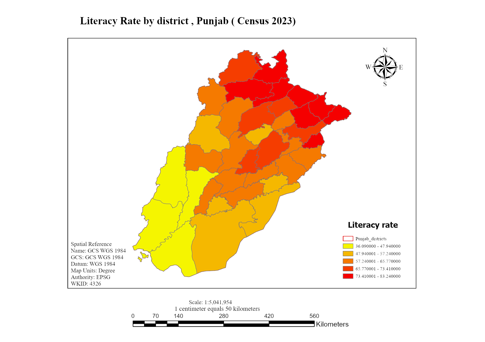

# Literacy Rate Mapping, Punjab, Pakistan (2023 Census)

## Overview
District-level map of literacy rates across Punjab using the 2023 Digital Population & Housing Census, with population shown alongside to compare education levels with demographic exposure.

## Data
- 2023 Digital Population & Housing Census (total population, urban/rural distribution, literacy %)
- Punjab district boundaries [add source]

## Method
1. Extracted the district shapefile for Punjab.
2. Joined the census tables to the district layer in ArcGIS Pro using Attribute Join and Relate.
3. Classified literacy rate using [method, e.g. Natural Breaks, number of classes].
4. Built a choropleth literacy map with [proportional symbols] for population.

## Key finding
Northern and central districts (e.g. Rawalpindi, Lahore, Gujrat) show higher literacy than southern Punjab. [Add one specific number if you have it.]

## Tools
ArcGIS Pro

## Files
- `Punjab_Literacy_Rate.png.png`: final map layout
- `Punjab_Literacy_rate.ppkx`: ArcGIS Pro project package (open in ArcGIS Pro, all data included)
